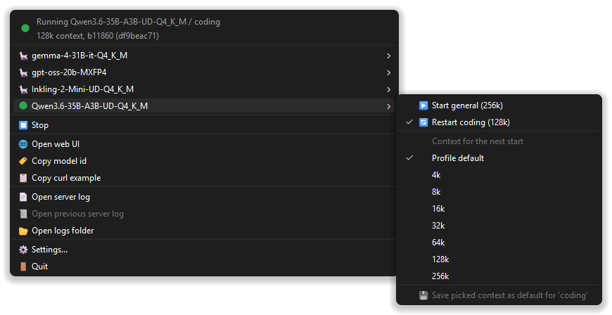
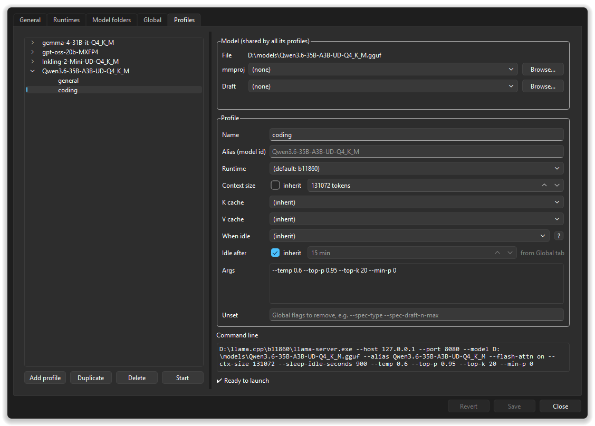

# llama-launcher 

Windows tray app that runs local GGUF models through llama-server, one at a time,
with per-model launch profiles and your own llama.cpp builds.

## Requirements

- Windows 10 or later, Python 3.13 (to run from source).
- A llama.cpp `llama-server` build (a release zip or your own); the app does not ship one.
- GGUF models.

## Run

```powershell
py -3.13 -m venv .venv
.venv\Scripts\python.exe -m pip install -e .[dev]
.venv\Scripts\pythonw.exe -m llama_launcher

# packaged build: dist\llama-launcher\llama-launcher.exe
.venv\Scripts\python.exe -m pip install -e .[build]
.venv\Scripts\python.exe tools\build.py
```

Settings, profiles and logs live in `%LOCALAPPDATA%\llama-launcher\`
(override with `LLAMA_LAUNCHER_HOME`).

## Screenshots

<p>
  <a href="https://raw.githubusercontent.com/hhuangpanda/llama-launcher/main/docs/images/tray-menu.png"></a>
  <a href="https://raw.githubusercontent.com/hhuangpanda/llama-launcher/main/docs/images/settings-profiles.png"></a>
</p>

## Concepts

- **Runtime**: a folder with `llama-server.exe` and its DLLs (a release zip or your own build).
  One is the default; a profile can pick another.
- **Model folders**: scanned recursively.
  GGUF headers decide what each file is:
  models,
  mmproj files (paired when `clip.vision.projection_dim` equals the model's `embedding_length`)
  and draft heads (`<arch>-assistant`).
  A sidecar is attached automatically only when exactly one fits in the model's own folder.
- **Profile**: one way to launch a model.
  A model can have several.
  Every scanned model has an implicit `default_profile` until you save one.
- **Flags** are layered, later wins per flag
  (aliases like `-c`/`--ctx-size` and `--x`/`--no-x` count as one flag):
  model fields, global K/V and idle, global args, profile `unset`, profile fields, profile args,
  then the context picked in the tray.
  `--host`, `--port`, `--api-key` and `--model` are managed by the app.
  Flags the selected build doesn't know are rejected before launch.
- **Idle**: `sleep` passes `--sleep-idle-seconds` (VRAM freed, next request reloads),
  `stop` ends the process once llama-server reports it is asleep,
  `off` keeps the model loaded.

## Files

`settings.toml` and `profiles.toml` are meant to be hand-editable;
the app reloads them on change and keeps the last good version if an edit doesn't parse.
Logs: `logs\server.log` (current or last server run, with the full command line)
and `server.prev.log`, `app.log` and `app.prev.log`.

## Importing existing launch commands

Profiles can be created from llama-server command lines you already use (`.bat` files, scripts):

```powershell
.venv\Scripts\python.exe -m llama_launcher.cmdimport commands.json            # dry run: shows what would change
.venv\Scripts\python.exe -m llama_launcher.cmdimport commands.json --write    # apply
```

`commands.json` is a list of `{"name": "...", "command": [...]}`,
where `command` is the full llama-server command line (exe first), as a list or one string;
`-` reads it from stdin.

- The exe's folder becomes a runtime;
  `-m`, `--mmproj`, `-md`, `--alias`, `-c`, `-ctk`, `-ctv` become model/profile fields;
  everything else goes to the profile's args.
- When global args are empty, flags every command shares become the global args.
- Runtimes and model folders are matched by path.
  A profile that exists with other settings is reported as a conflict and skipped unless `--replace` is given;
  re-running adds nothing.
- Each result says whether the profile rebuilds exactly the flags of the original command.

## Tests

```powershell
.venv\Scripts\python.exe -m pytest              # unit, integration (fake server), UI
```

`pytest -m real` loads real models;
set `LLAMA_LAUNCHER_TEST_MODELS` (a model folder)
and `LLAMA_LAUNCHER_TEST_RUNTIMES` (llama-server folders, `;`-separated) first,
in the environment or in a git-ignored `.env` (copy `.env.example`).
Test IDs are listed in [docs/test-cases.md](https://github.com/hhuangpanda/llama-launcher/blob/main/docs/test-cases.md).

## License

MIT, see [LICENSE](https://github.com/hhuangpanda/llama-launcher/blob/main/LICENSE).
